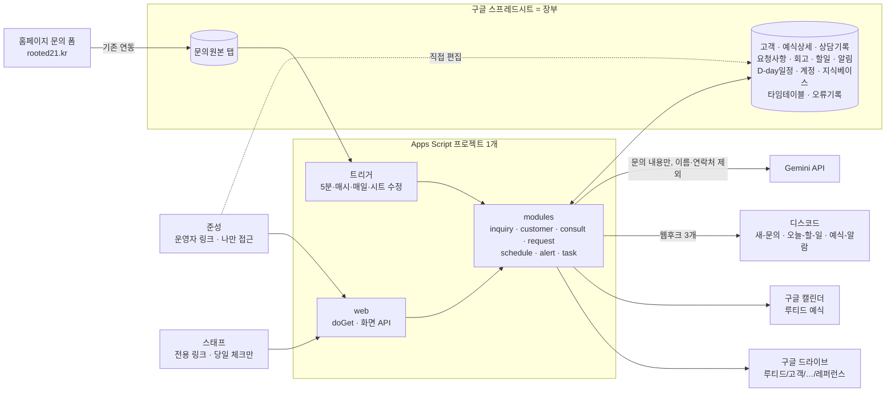

# 루티드 관리 화면 기술 요구사항 (TRD)

상태: 완료 (2026-10-23 확정 — 추정 6개 항목 포함 그대로 승인)

## ① 선택한 스택과 이유

**패키지: Apps Script 웹앱 + 구글 시트** (Next.js 안을 검토한 뒤 변경 확정)

| 역할 | 선택 | 쉬운 설명 |
|---|---|---|
| 화면(프론트엔드) | Apps Script HtmlService 웹앱 — HTML + CSS + Alpine.js(CDN, 3.x 고정 버전) | 시트에 붙은 웹페이지. Alpine.js는 버튼·체크 반응을 짧은 코드로 붙이는 작은 도구 |
| 주방(백엔드) | Apps Script 서버 함수 (`google.script.run`으로 화면과 연결) | 화면이 부르면 시트를 읽고 쓰는 함수 |
| 장부(데이터베이스) | 구글 시트 (탭별 표) | 준성이 직접 고칠 수 있는 장부 그대로 |
| 자동화 | Apps Script 트리거(시트 수정 감지·시간 기반) | 정해진 때 스스로 돌아가는 알람시계 |
| 외부 서비스 | Gemini API, 디스코드 웹후크 3개, 구글 캘린더, 구글 드라이브 | |
| 개발 도구 | VS Code + clasp + Git | 코드는 내 컴퓨터에서 쓰고 Git으로 기록, clasp로 구글에 올림 |
| 1차 실행 기준 | 준성 계정 전용 테스트 링크(/dev) — 폰에서도 열림 | localhost 역할. 스태프용 정식 링크(배포)는 마지막 선택 단계 |

**선택 이유**
- 장부가 구글 시트라는 PRD 조건과 "시트에서 고치고 화면은 읽어 보여준다"는 FRD 편집 원칙에 그대로 맞는다.
- 홈페이지 문의 폼이 이미 구글 스프레드시트로 들어오도록 연동돼 있어, 같은 구글 안에서 바로 이어받는다.
- 모바일 화면(오늘·당일 체크)을 개발 중에도 폰으로 바로 확인할 수 있다.
- 추가 가입 서비스가 없고 월 0원으로 시작한다.

**비교했던 대안**
- Next.js 화면 + 구글 시트 API + Apps Script: 화면은 빠르지만 localhost는 폰에서 열 수 없어 현장 사용에 Vercel 배포가 필수가 되고, 구글 클라우드 로그인·서비스 계정 키 설정이 추가된다. → 변경
- Next.js + Supabase: 장부가 시트와 DB 둘로 갈라져 동기화가 필요하다. → 제외
- Glide·AppSheet 같은 노코드 빌더: 시안의 여정 바·칸반 재현이 어렵고 사용자 수만큼 요금 발생. → 제외

**알고 있어야 할 한계**
- 페이지를 열 때 1~3초 걸린다(시트 읽기). 자주 읽는 값은 60초 캐시로 줄인다.
- 구글 무료 계정 할당량 안에서 동작한다 (스크립트 1회 실행 최대 6분, 트리거 실행 합계 하루 90분, 외부 호출 하루 2만 회). 루티드 규모(하루 문의 수 건)에서는 여유가 크다.

**시작 상태**: 6시간 MVP는 아직 시작 전. 시트 구조부터 이 TRD로 새로 설계하고, 6시간 MVP 작업은 개발 계획 앞부분에 들어간다. 홈페이지 문의 폼 → 구글 스프레드시트 연동은 이미 되어 있다(이하 "운영 시트"). 개발·테스트는 별도 개발용 시트에서 하고, 운영 시트 링크는 준성이 운영 연결 단계에서 제공한다.

## ② 시스템 구조



## ③ 데이터 모델

엑셀 파일 하나(스프레드시트)에 탭 13개. 열 이름 앞의 `_`는 스크립트가 채우는 칸(준성이 고치지 않음).

### 문의원본 (홈페이지 폼이 쓰는 탭)

홈페이지 폼이 이미 쓰고 있는 열 구조를 그대로 둔다. 스크립트는 5분마다 새 행을 읽어 고객 탭으로 옮기고, 원본 행 끝 `_옮김` 칸에 고객ID를 적는다. (확정 — 폼 쪽 열 구조를 건드리지 않기 위해 분리)

- **개발 중**: 개발용 시트에 기획서 문의 6칸(이름·연락처·행사 종류·희망 날짜·낮/저녁·예상 인원 + 문의 내용)을 가정한 '문의원본' 탭을 만들어 테스트한다.
- **운영 연결 시**: 준성이 홈페이지와 연결된 실제 스프레드시트 링크를 주면, 그 시트의 실제 열 이름을 읽어 `config.js`의 대응표만 고친다. 옮기는 함수와 나머지 코드는 바꾸지 않는다.

### 고객 (메인, 1명 = 1행)

| 묶음 | 열 |
|---|---|
| 식별 | 고객ID |
| 문의(자동 옮김) | 접수일시, 이름, 연락처, 행사종류, 희망날짜1, 희망날짜2, 희망슬롯, 예상인원, 유입경로, 문의내용, 견적기금액 (폼이 보낼 때만) |
| 영업(시트 입력) | 진행단계, 첫연락일, 답사일, 견적발송일, 분위기, 예산감, 중요기준, 결정권자, 하객지역, 특이사항 |
| 계약(시트 입력) | 계약일, 예식일, 예식슬롯, 패키지, 옵션, 총액, 계약금, 계약금입금일, 중도금, 중도금입금일, 잔금, 잔금입금일, 초상권동의 |
| 사후(시트 입력) | 원본수령, 후기요청일, 후기작성, 콘텐츠활용, 회고메모 |
| 실패(시트 입력) | 실패단계, 실패사유 |
| 자동 | _예약가능, _브리핑요약, _통화포인트, _문자초안, _브리핑상태, _일정기준예식일, _드라이브폴더 |

예시: `R-261023-001 | 2026-10-23 09:12 | 김하은 | 010-1234-5678 | 웨딩 | 2027-04-18 | 2027-04-25 | 낮 | 90 | 인스타그램 | 숲 배경 본식 희망… | 1,240만 | 문의 | … | _예약가능: 검토 중 1팀`

- 입금 여부는 "입금일 칸이 채워져 있으면 입금"으로 판단한다 (칸 하나로 여부와 날짜를 함께 기록).
- 진행단계 칸은 드롭다운(문의/연락/답사/견적/계약/완료/실패)으로 고정해 오타를 막는다.

### 나머지 탭

| 탭 | 열 | 예시 한 줄 |
|---|---|---|
| 예식상세 | 고객ID, 최종인원, 알레르기, 입장동선, 축가, 음악큐시트, 외부업체연락처, 신부대기실시간 | R-…-001, 82, 견과류 1명, 버진로드 동시 입장, 1팀, (링크), 원판 작가 010-…, 11:30–13:00 |
| 상담기록 | 기록ID, 고객ID, 상담일, 방식, 요약, 사진폴더, 사진수, 작성자, 작성시각, 수정시각 | C-0001, R-…-001, 2026-10-15, 답사, 버진로드 생화 풍성하게…, (드라이브 링크), 8, 준성, … |
| 요청사항 | 요청ID, 고객ID, 파트, 내용, 출처기록ID, 사진링크, 고객확인일시, 상태(대기/확인/빠짐), 확인자, 확인시각 | Q-0001, R-…-001, 플라워, 아치 비대칭 그린·화이트, C-0001, (링크), 2026-10-31, 확인, 수진, 11:42 |
| 회고 | 회고ID, 고객ID, 예식일, 요청ID, 사유, 기록자, 기록시각 | V-0001, R-…-001, 2026-11-07, Q-0002, 비건 플레이트 2개만 준비됨, 수진, … |
| 할일 | 할일ID, 날짜, 내용, 고객ID, 출처(자동/직접), 완료, 완료자, 완료시각, _중복키 | T-0001, 2026-10-23, 김하은 첫 연락, R-…, 자동, FALSE, , , R-…:첫연락 |
| 알림 | 알림ID, 발생시각, 고객ID, 종류, 내용, 채널, 급함, 읽음, 읽은시각, 해제, 보류, 디스코드전송, _중복키 | N-0001, …, R-…-001, D-14, 잔금 미입금 1,240만, 예식-알람, TRUE, FALSE, , FALSE, FALSE, 완료, R-…:D-14 |
| D-day일정 | 일정ID, 고객ID, 시점, 날짜, 내용, 캘린더이벤트ID, 상태 | S-0001, R-…-001, D-90, 2026-08-09, 중도금 요청, (이벤트ID), 지남 |
| 계정 | 이름, 권한(운영자/스태프), 이메일, _링크토큰, 활성 | 수진, 스태프, , (긴 무작위 문자열), TRUE |
| 지식베이스 | 항목, 내용 | 포함 항목, 전날 방역·예초·신부대기실… |
| 타임테이블 | 슬롯, 시각, 내용 | 낮, 13:00, 본식 시작 |
| 오류기록 | 시각, 작업, 고객ID, 메시지 | …, Gemini 브리핑, R-…, 응답 시간 초과 |

- `_중복키`는 같은 할 일·알림이 두 번 생기지 않게 하는 이름표다.
- 알림의 `보류`는 예식 당일 미응대 알림을 다음 날 아침 요약으로 미룬 상태다.

## 인증과 권한

### 접속 방식 (FRD 정책을 기술 제약에 맞춰 조정, R2 확정)

Apps Script 웹앱을 준성 권한으로 실행하면 일반 gmail 계정을 쓰는 다른 사람의 이메일은 확인할 수 없다(구글 정책). 그래서 같은 코드를 **링크 두 개**로 배포한다.

| 링크 | 구글 배포 설정 | 들어오는 사람 | 확인 방법 |
|---|---|---|---|
| 운영자 링크 | 실행: 나(준성) / 접근: 나만 | 준성 | 구글이 준성 계정만 통과시킨다 (개발 중에는 /dev 테스트 링크가 같은 역할) |
| 스태프 링크 | 실행: 나(준성) / 접근: 누구나 | 스태프 | 주소 끝 전용 토큰을 '계정' 탭과 대조. 토큰이 없거나 '활성'이 꺼져 있으면 "접근 권한 없음" |

- 스태프 토큰은 32자 이상 무작위 문자열. '계정' 탭에서 행을 추가하면 시트 메뉴 "스태프 링크 만들기"로 발급하고, 퇴사·유출 시 '활성'을 끄거나 "링크 다시 만들기"로 바꾼다.
- 화면이 부르는 서버 함수는 **매번** 권한을 다시 확인한다. 스태프 토큰으로는 당일 체크 함수만 통과한다.
- 상담 기록·회고의 작성자는 운영자 링크면 "준성", 스태프 링크면 '계정' 탭의 이름으로 기록한다.

### 기능별 접근 규칙

| 기능 (FRD ID) | 운영자 링크 | 스태프 링크 | 토큰 없음·비활성 |
|---|---|---|---|
| 운영 보드, 고객 목록, 알림함 (F2·F3·F4) | 가능 | 불가 | 불가 |
| 고객 사이클, 입금 확인, 연락처 보기 (F5) | 가능 | 불가 | 불가 |
| 상담 기록, 요청사항 작성·수정·삭제 (F6·F7) | 가능 | 불가 | 불가 |
| 문의 브리핑, 첫 연락 완료 (F10) | 가능 | 불가 | 불가 |
| 오늘 (F8) | 가능 | 불가 | 불가 |
| 예식 당일 체크 — 보기, 체크, 빠짐 (F9) | 모든 예식 | 오늘·내일 예식만 | 불가 |
| 계정 관리 (F1.3) | 시트에서 | 불가 | 불가 |

## 외부 서비스

| 서비스 | 용도 (FRD ID) | 연결 방식 | 비용 |
|---|---|---|---|
| 구글 스프레드시트 | 장부 전체 | Apps Script 기본 | 0원 |
| 홈페이지 폼 연동 | 문의 유입 (F11.1) | 기존 연동 유지 → 문의원본 탭 | 0원 |
| Gemini API (Flash 계열) | 브리핑·통화 포인트·문자 초안 (F11.1) | API 키를 스크립트 속성에 저장, `UrlFetchApp`으로 호출 | 유료 종량제 사용 (확정) — 건당 약 5원 |
| 디스코드 웹후크 3개 | #새-문의, #오늘-할-일, #예식-알람 (F11.3·F11.5·F11.6) | 웹후크 주소를 스크립트 속성에 저장. 급함 알림은 준성 멘션 | 0원 |
| 구글 캘린더 | D-day 일정 (F11.2) | 전용 캘린더 "루티드 예식"을 새로 만들어 사용 (확정) | 0원 |
| 구글 드라이브 | 레퍼런스 사진 (F6.5·F6.6·F9.6) | 고객 폴더 `루티드/고객/예식일_이름/레퍼런스` 자동 생성. 사진은 서버가 미리보기 주소를 받아 화면에 전달(스태프도 구글 로그인 없이 볼 수 있게) | 15GB 무료 (gmail과 공유) |

- **Gemini 요금제**: 무료 등급은 입력 내용이 구글 제품 개선에 쓰일 수 있어, 이름·연락처를 빼더라도 상담 문의 원문이 넘어간다. 유료 종량제는 그렇지 않다. 문의 1건당 지식베이스 포함 입력 약 5천 토큰·출력 약 8백 토큰으로 약 5원, 월 100건이면 약 500원. (확정 — 결제 수단 등록 필요, 요금은 가입 시점 구글 요금표로 확인)
- Gemini 호출 실패 시 1회 재시도 후 `_브리핑상태 = 실패`로 두고 브리핑 없이 디스코드에 알린다 (FRD 시나리오 1 예외).

## 자동화 트리거 (알람시계)

| 트리거 | 주기 | 하는 일 (FRD ID) |
|---|---|---|
| 문의 확인 | 5분마다 | 문의원본 새 행 → 고객 탭 옮김, 예약 가능 판단, Gemini 브리핑, #새-문의 (F11.1) |
| 시트 수정 감지 | 준성이 시트를 고칠 때 | 예식일 바뀜 → D-day 일정·캘린더 재계산 (F11.2) / 입금일 채워짐 → 미입금 급함 해제 (F11.7) |
| 알림 점검 | 매시 정각 | 24시간 미응대, 답사 전날, 견적 후 3·7일, D-day 시점 알림 생성 (F11.3), 예식 당일 보류 처리 |
| 아침 준비 | 매일 07:00 | 오늘 예식 파트별 체크리스트 → #예식-알람 (F11.6) (확정) |
| 아침 요약 | 매일 08:00 | 할 일 자동 생성(F11.4), 오늘 할 일·이번 주 행사·미입금·미응대·보류 알림·지난밤 오류 → #오늘-할-일 (F11.5) (확정) |
| 전날 준비 | 매일 18:00 | 내일 예식 파트별 체크리스트 → #예식-알람 (F11.6) (확정) |

## 표준 적용 방식 (FRD ⑦ 이어받음)

- **접속·권한 확인은 서버에서**: 모든 서버 함수 첫 줄에서 `access.js`가 링크 종류와 토큰을 확인한다 — 화면 코드를 고쳐도 데이터를 받을 수 없게.
- **연락처 가림**: 서버가 처음부터 뒷자리 4개만 보내고, "연락처 보기"를 누를 때 운영자 확인 후 전체 번호를 따로 보낸다.
- **AI에 개인정보 미전송**: Gemini 요청에는 행사 종류·날짜·인원·유입 경로·문의 내용·지식베이스만 넣는다. 이름·연락처는 응답을 받은 뒤 스크립트가 디스코드 메시지에 붙인다.
- **비밀값 보관**: Gemini 키, 디스코드 웹후크 3개, 스프레드시트 ID는 스크립트 속성(비밀 설정 저장소)에 둔다. Git에 올라가는 코드에는 들어가지 않는다.
- **동시 저장 충돌 방지**: 시트에 쓰는 함수는 잠금(LockService)을 걸어 한 번에 하나씩 쓴다 — 당일 체크를 두 사람이 동시에 눌러도 행이 꼬이지 않게.
- **중복 방지**: 알림·할 일은 `_중복키`, 브리핑은 `_브리핑상태`, 문의 옮김은 `_옮김`으로 처리 여부를 기록한다.
- **시간대 고정**: `appsscript.json` 시간대를 Asia/Seoul로 두고, 날짜 계산은 `dates.js` 한 곳에서만 한다.
- **실패 기록**: 모든 트리거는 오류를 잡아 오류기록 탭에 남기고, 다음 아침 요약에 포함한다.
- **캐시**: 지식베이스·타임테이블·계정은 10분, 고객 목록은 60초 캐시. 화면에서 쓰기가 일어나면 해당 캐시를 지운다.

## 시드 데이터 (개발용 가짜 데이터)

- 실제 고객 데이터와 섞이지 않도록 **개발용 스프레드시트 사본**을 따로 만든다. 스크립트 속성의 스프레드시트 ID만 바꿔 개발용/운영용을 전환한다.
- `dev/seed.js`의 "가짜 고객 만들기"를 실행하면 가짜 고객 10명을 단계별로 채운다: 문의 2(그중 1명은 25시간 전 접수 → 미응대 급함), 연락 2, 답사 1, 견적 2, 계약 2(예식 D-14 잔금 미입금 1명, 오늘 예식 1명), 실패 1.
- 오늘 예식 고객에게 상담 기록 3건, 요청사항 6건(파트별 1건 이상), 레퍼런스 사진 폴더(샘플 이미지 3장)를 함께 만든다.
- "개발용 시트 초기화"는 개발용 시트에서만 동작한다 (운영용 ID면 실행 거부).
- 기획서의 "가짜 고객 3명으로 전체 흐름 테스트"는 이 시드로 대신한다.

## ④ 폴더 구조

모듈러 모놀리식: 기능별 폴더로 나누되 한 Apps Script 프로젝트 안에 둔다.

```
rooted-admin/
├─ .clasp.json            # 어느 Apps Script 프로젝트로 올릴지
├─ .claspignore           # 올리지 않을 파일
├─ appsscript.json        # 시간대 Asia/Seoul, 웹앱 설정, 권한 범위
├─ README.md
└─ src/
   ├─ core/               # 모든 기능이 같이 쓰는 기본기
   │  ├─ config.js        # 탭·열 이름, 문의원본 열 대응표, 채널 이름 (키는 넣지 않음)
   │  ├─ sheet.js         # 시트 읽기·쓰기·잠금·캐시 공통 함수
   │  ├─ access.js        # 링크 종류·토큰 확인, 권한 확인
   │  ├─ dates.js         # 한국 시간, D-day 계산
   │  └─ errors.js        # 오류기록 탭에 남기기
   ├─ modules/            # 기능별 방 (FRD ID와 대응)
   │  ├─ inquiry/         # F10, F11.1 — 문의 옮김, 예약 가능 판단, Gemini 브리핑
   │  ├─ customer/        # F4, F5 — 고객 목록·사이클·입금 확인·연락처 보기
   │  ├─ consult/         # F6 — 상담 기록, 드라이브 사진
   │  ├─ request/         # F7, F9 — 요청사항, 당일 체크, 회고
   │  ├─ schedule/        # F11.2 — D-day 계산, 캘린더
   │  ├─ alert/           # F2, F11.3, F11.6, F11.7 — 알림 생성·해제·보류, 디스코드
   │  └─ task/            # F3, F11.4, F11.5 — 할 일, 아침 요약
   ├─ web/                # doGet(링크·권한에 따라 화면 고르기), 화면이 부르는 API 목록
   ├─ triggers/           # 5분·매시·매일·시트 수정 트리거, 시트 메뉴(스태프 링크 만들기)
   ├─ ui/                 # 화면 HTML
   │  ├─ layout.html      # 사이드바·하단 탭·디자인 토큰(CSS 변수, docs/design-prompt.md 기준)
   │  ├─ pages/           # board, customers, customer, alerts, today, consult, dayof, denied
   │  └─ components/      # 여정 바, 알림 행, 체크 행, 칩, 토스트, 바텀시트, 사진 보기
   └─ dev/                # 가짜 고객 시드, 개발용 시트 초기화
```

clasp는 폴더를 `modules/inquiry/briefing` 같은 이름의 파일로 펼쳐 올리므로 로컬 폴더 구조가 그대로 유지된다.

## ⑤ 실행과 배포 방법

**1차 기준 — 내 계정 안에서 실행 (localhost 역할)**
1. Node.js 설치 → `npm install -g @google/clasp` → `clasp login` (준성 구글 계정)
2. 개발용 스프레드시트 사본을 만들고, 그 시트에 붙은 Apps Script 프로젝트에 `clasp clone`으로 연결
3. 스크립트 속성에 개발용 시트 ID, Gemini 키, 디스코드 웹후크 3개를 넣는다
4. VS Code에서 코드 작성 → `clasp push` → 편집기의 "테스트 배포" 링크(/dev)를 PC와 폰에서 연다
5. `dev/seed.js`로 가짜 고객을 채우고 트리거를 설치해 흐름을 확인한다
6. 코드는 Git으로 커밋해 변경 이력을 남긴다 (GitHub 업로드는 선택)

**나중에 운영 시트에 연결하는 길 (선택 단계)**: 준성이 홈페이지와 연결된 운영 시트 링크를 주면 ① 운영 시트를 백업 사본으로 복제 ② 운영 시트에 고객·상담기록 등 나머지 탭 추가(폼이 쓰는 탭은 그대로 두고 '문의원본'으로 지정) ③ 실제 열 이름으로 `config.js` 대응표 수정 ④ 운영 시트에 붙은 Apps Script 프로젝트에 같은 코드를 `clasp push`하고 스크립트 속성을 운영용 값으로 바꾼다. 기존에 쌓인 문의는 "기존 문의 옮기기"를 한 번 실행해 고객 탭으로 옮긴다(브리핑·디스코드 전송은 건너뜀). Apps Script 편집기의 "배포 → 새 배포 → 웹앱"을 두 번 실행해 운영자 링크(접근: 나만)와 스태프 링크(접근: 누구나)를 만든다. 스태프에게는 시트 메뉴에서 발급한 전용 링크만 전달한다. Vercel 같은 별도 서비스 가입은 필요 없다.

## ⑥ 월 비용 추정

| 항목 | 무료 구간 | 유료 전환 시점 | 예상 월 비용 |
|---|---|---|---|
| Apps Script·시트·캘린더 | 무료 계정 할당량 (트리거 합계 하루 90분 등) | 하루 문의 수백 건 수준이 되면 할당량 점검 | 0원 |
| Gemini API | 무료 등급 있으나 사용하지 않음 (개인정보 사유) | 처음부터 유료 종량제 | 약 500원 (월 문의 100건 기준) |
| 디스코드 | 무료 | 해당 없음 | 0원 |
| 구글 드라이브 | 15GB (gmail·사진과 공유) | 레퍼런스 사진이 연 1.5GB 안팎 → 몇 년 뒤 15GB 근접 시 Google One 100GB | 0원 → 이후 월 약 2,400원 |
| **합계** | | | **월 약 500원** |

## ⑦ 바꾸기 어려운 결정

| 결정 | 나중에 바꾸려면 | 이유 |
|---|---|---|
| 장부 = 구글 시트 | 어려움 | 모든 기능이 시트 탭·열 구조에 기대고 있다. DB로 옮기려면 읽기·쓰기 전부를 다시 짜야 한다 |
| 화면 = Apps Script 웹앱 | 어려움 | 다른 프레임워크로 옮기면 화면 8개와 서버 연결을 새로 만든다 (시트와 자동화는 재사용 가능) |
| 고객ID 형식 (R-YYMMDD-NNN) | 보통 | 상담기록·요청사항·알림이 모두 이 ID로 연결된다 |
| 탭·열 이름 | 보통 | `config.js` 한 곳에 모아 두어 이름 변경은 한 파일 수정으로 끝나지만, 이미 쌓인 데이터의 열 순서는 맞춰야 한다 |
| 스태프 전용 링크 방식 | 쉬움~보통 | 나중에 구글 워크스페이스로 바꾸면 `access.js`만 고치면 된다 |
| 문의원본 탭 분리 | 쉬움 | 폼 연결 방식이 바뀌어도 옮기는 함수 하나만 고친다 |
| Gemini 모델 | 쉬움 | 모델 이름은 스크립트 속성 값 하나 |
